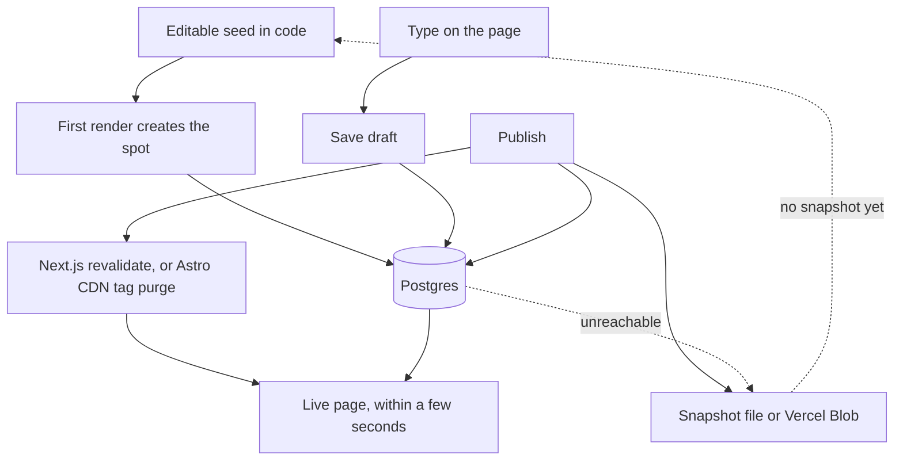

# Architecture

Inplace stores published copy in Postgres and shows it on the live page. The string inside `<Editable>` is a seed, not a second source of truth after the first save.



The first time a spot renders against a database, the seed is copied into Postgres. After that, edits in the repo do not change the live words. On a preview URL, or after a client signs in, the words are editable immediately. Publish copies every draft onto the published value, stores a numbered version with the actor (`preview` or the client’s email), writes the snapshot, and tells the host to drop the cached page. The page the client is looking at does not reload.

## Data model

Every spot stores a tagged value. Version 1 accepts text only:

```ts
{ type: "text", value: "Rooms that hold the light." }
```

Versions are a map of those values plus an `actor` (`preview` or the session email) and an optional `restoredFrom` version number. Draft rows remember `updated_by` the same way.

The tag is there so later types do not need a new table:

- **Images.** `{ type: "image", src: string, alt: string }`
- **Spacing.** `{ type: "spacing", padding: BoxEdges, margin: BoxEdges }`

Unknown types are rejected on write. History, restore, and undo are an API, not buttons. See [api.md](api.md).

## When Postgres is down

The page tries the database, then the snapshot, then the seed. Any database error during render, including a missing column, is logged and does not become a 500. The snapshot is `.inplace/<siteId>.json`, then the temp directory, then Vercel Blob when `BLOB_READ_WRITE_TOKEN` is set. Files and blobs written under the older `.site-editor` / `site-editor/` paths are still read.

## Schema

`001_init.sql` and `002_actor.sql` still create `site_editor_*` tables, so a database that already applied them is not asked to create a second empty copy. `003_rename.sql` renames those tables to `inplace_*` when the new name is absent. If both names exist and the old table is empty, the old table is dropped. If both names exist and the old table has rows, it is left in place.

The version lives in `inplace_schema` after the rename, and in `site_editor_schema` until then. The first request applies whatever files are newer than that version, under `pg_advisory_xact_lock`, unless `INPLACE_AUTO_MIGRATE=0`.

## Adapters

Next.js caches the published map with `unstable_cache` and drops it on publish. Astro renders on each origin request and lets the CDN hold the HTML for a few seconds, then purges the tag. Both adapters share the HTTP handler, the Postgres store, and the snapshot writer.
